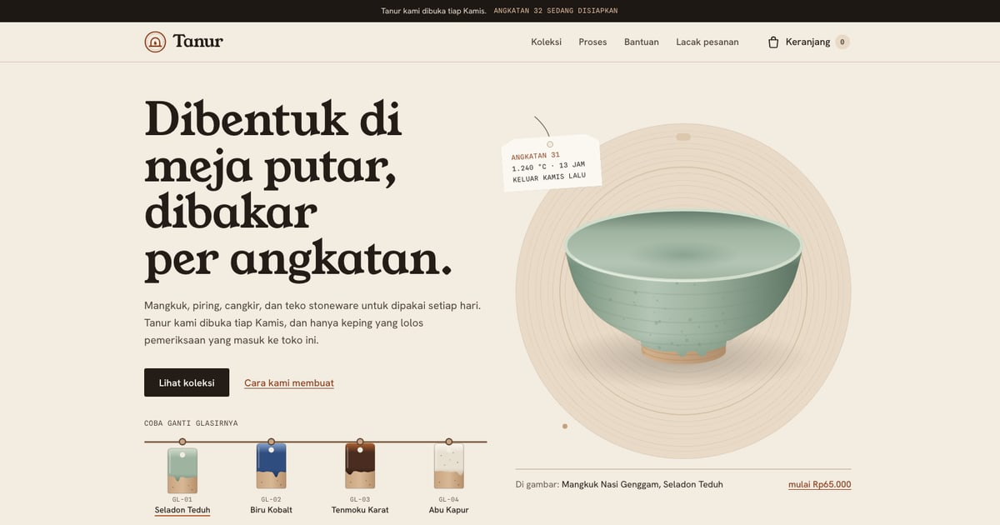

# Tanur — Keramik buatan tangan

Toko online demo untuk paket **Toko Online** PintuWeb. Tanur adalah studio keramik fiktif yang menjual mangkuk, piring, cangkir, teko, dan vas stoneware. Semua alur belanja berjalan sungguhan di browser: katalog bersaring, varian glasir dan ukuran dengan stok masing-masing, keranjang, checkout dengan ongkir otomatis, halaman pesanan, lacak pesanan, dan dasbor penjual.

**Demo live:** https://toko-tanur.pintuweb.id



> Tanur adalah toko fiktif. Produk, harga, stok, tarif ongkir, kebijakan, dan pesanan contoh semuanya rekaan. Tidak ada pembayaran sungguhan, tidak ada kurir sungguhan, dan tidak ada data yang dikirim ke server: keranjang, pesanan, dan perubahan stok disimpan di `localStorage` browser pengunjung.

## Yang diperlihatkan

- **Varian dengan stok sendiri.** Tiap produk punya pilihan glasir × ukuran/isi set. Harga bisa berbeda per varian (glasir kobalt lebih mahal), stok dihitung per varian, varian habis tidak bisa dipilih, dan jumlah beli dibatasi stok dikurangi yang sudah ada di keranjang.
- **Ongkir otomatis.** Berat keping + kemasan (25%, minimal 300 g) + peti kayu opsional, dibulatkan ke atas per kg, dikalikan tabel contoh tarif zona × layanan (Reguler/Kilat). Kilat tidak tersedia untuk Zona 4. Rinciannya ditampilkan di checkout.
- **Validasi formulir yang ramah.** Galat tampil di bawah isian setelah disentuh, ringkasan galat muncul saat kirim, dan fokus pindah ke isian pertama yang salah.
- **Pesanan dan status.** Kode pesanan `TNR-YYMM-NNNN`, linimasa Menunggu pembayaran → Dibayar → Dikemas → Dikirim → Selesai dengan waktu WIB, tombol *Simulasikan pembayaran*, resi contoh, dan faktur yang bisa dicetak (CSS cetak tersendiri).
- **Lacak pesanan** dengan kode + 4 angka terakhir nomor HP sebagai faktor kedua.
- **Dasbor demo** tanpa login: ringkasan penjualan hari ini dan 7 hari (dihitung per tanggal WIB), grafik harian dengan tabel pengganti, daftar pesanan bersaring status yang bisa diubah, daftar stok menipis, editor stok per varian, sakelar jual/nonaktif, dan tombol *Kembalikan data contoh*.
- **Pesanan contoh** dibuat saat kunjungan pertama dengan tanggal relatif terhadap hari itu (WIB), jadi dasbor tidak pernah kosong atau basi.

## Identitas visual

- **Huruf:** Young Serif (judul), Hanken Grotesk (teks), Spline Sans Mono (label log tanur). Semuanya lewat `next/font`, variabel dipasang di `<html>`.
- **Warna:** krem bisque, tanah liat, tinta arang, ditambah empat glasir: Seladon Teduh, Biru Kobalt, Tenmoku Karat, Abu Kapur.
- **Motif:** ubin uji glasir berlubang gantung (dipakai sebagai pemilih glasir), cap pembuat berbentuk lengkung tanur, label angkatan tanur, cincin bekas meja putar, kurva bakar 30 jam, dan diagram urai lapisan kemasan.
- **Ilustrasi produk** digambar dengan SVG di `components/Ware.js`: satu gaya untuk semua keping (tampak tiga perempat, kaki tanpa glasir, tetesan glasir, bintik besi, garis putaran). Warna ilustrasi ikut glasir yang dipilih, dan set digambar sesuai isinya.

## Halaman

| Rute | Isi |
| --- | --- |
| `/` | Pahlawan dengan mangkuk yang glasirnya bisa diganti lewat ubin uji, bento kategori dan glasir, paling sering dipesan, proses dan kurva bakar, kemasan dan ongkir, kartu rawat |
| `/koleksi` | Saring kategori, glasir, rentang harga, pencarian, urutan, jumlah hasil, keadaan kosong; semua saringan tercermin di URL |
| `/produk/[slug]` | 14 halaman statis (`generateStaticParams`): galeri, pemilih glasir dan ukuran, stok per varian, berat dan ukuran, perawatan, catatan buatan tangan, produk terkait |
| `/keranjang` | Ubah jumlah sesuai stok, hapus, subtotal, berat, bilah checkout lengket di ponsel |
| `/checkout` | Alamat, layanan kirim, packing kayu, cara bayar (mode demo), ringkasan |
| `/pesanan/[kode]` | Konfirmasi, linimasa status, simulasi bayar, faktur cetak |
| `/lacak` | Lacak dengan kode + 4 angka terakhir HP |
| `/admin` | Dasbor demo, data tersimpan di browser |
| `/bantuan` | Pengiriman, packing dan keping pecah, tukar dan retur, perawatan, tentang toko demo |

Ditambah halaman 404 bergaya Tanur, `sitemap.xml`, `robots.txt`, metadata per halaman, Open Graph, JSON-LD `WebSite`, dan ikon SVG.

## Model data

Semua isi toko ada di `lib/data.js`:

- `site`: nama, alamat situs, awalan kode pesanan, hari tanur dibuka, batas bayar.
- `kategori`, `glasir` (warna, kode ubin uji, catatan).
- `produk`: `slug`, `kategori`, `bentuk` (untuk ilustrasi), `glasir[]`, `ukuran[]` (`label`, `detail`, `harga`, `berat` dalam gram), `tambahanGlasir` (selisih harga per glasir), `stok` (`{ glasir: [stok per ukuran] }`), `angkatan`, `terjual` (untuk urutan "paling sering dipesan"), `foto[]`.
- `zonaOngkir` (38 provinsi dalam 4 zona, tarif per kg per layanan), `kemasan`, `metodeBayar`, `statusPesanan`, `kurvaBakar`, `faq`.

Logika ada di `lib/katalog.js` (varian, harga, stok, saringan), `lib/ongkir.js`, `lib/pesanan.js` (kode, status, ringkasan penjualan, pesanan contoh), dan `lib/format.js` (Rupiah, gram, waktu WIB). Penyimpanan browser ada di `lib/store.js` dengan kunci berversi:

| Kunci `localStorage` | Isi |
| --- | --- |
| `tanur.cart.v1` | Keranjang: `{ slug, glasir, ukuran, qty }` |
| `tanur.orders.v1` | Pesanan, termasuk riwayat status dan waktu |
| `tanur.inventory.v1` | Perubahan stok dan status jual dari dasbor |
| `tanur.seq.v1` | Nomor urut pesanan terakhir |
| `tanur.seeded.v1` | Penanda pesanan contoh sudah dibuat |

## Teknologi

- Next.js 15.5 (App Router) dan React 19, JavaScript
- Tailwind CSS v4 (`@theme` di `app/globals.css`)
- Tanpa backend dan tanpa variabel lingkungan

## Menjalankan secara lokal

```bash
npm install
npm run dev
```

Buka http://localhost:3000. Build produksi: `npm run build` lalu `npm start`. Pemeriksaan kode: `npm run lint`.

## Kredit foto

Semua foto berlisensi CC0 1.0 (domain publik), dicari lewat [Openverse](https://openverse.org), dipotong, lalu dikonversi ke WebP. Tidak ada wajah yang dikenali. Ilustrasi produk digambar sendiri dengan SVG, bukan foto.

| Berkas | Judul asli | Pembuat | Sumber | Lisensi |
| --- | --- | --- | --- | --- |
| `proses-putar.webp` | Free person making handmade pottery | tidak dicantumkan | [rawpixel](https://www.rawpixel.com/image/5914897/image-public-domain-art-free) | CC0 1.0 |
| `proses-uleni.webp` | Clay Hands | Alex Jones | [StockSnap](https://stocksnap.io/photo/clay-hands-469424D4C3) | CC0 1.0 |
| `proses-rapikan.webp` | Free person making handmade pottery | tidak dicantumkan | [rawpixel](https://www.rawpixel.com/image/5924342/photo-image-public-domain-art-free) | CC0 1.0 |
| `foto-mug-abu.webp` | Ceramic mug wooden table | tidak dicantumkan | [rawpixel](https://www.rawpixel.com/image/3283727/free-photo-image-coffee-table-wooden) | CC0 1.0 |
| `foto-teko-tenmoku.webp` | Ceramic Teapot | Nashad Abdu | [StockSnap](https://stocksnap.io/photo/ceramic-teapot-5811FEC469) | CC0 1.0 |

---

Dibuat oleh [PintuWeb](https://www.pintuweb.id), jasa pembuatan website.
